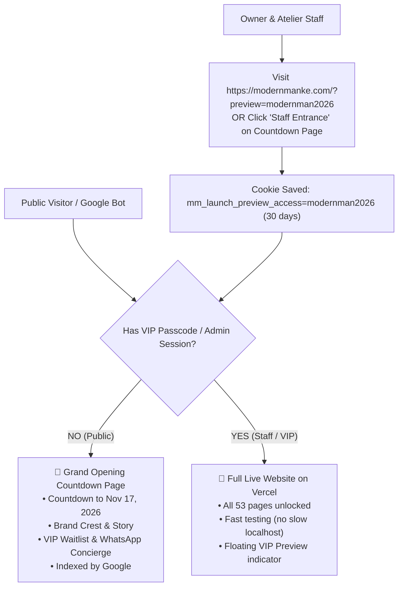

# 👔 Modern Man Kenya — Pre-Launch, Domain & Grand Opening Protocol

This master guide explains the architecture, Namecheap domain configuration, VIP testing bypass, and official launch switch for **Modern Man Kenya** (`modernmanke.com`).

---

## 🏛️ 1. Architecture Overview



---

## 🌐 2. Connecting Namecheap to Vercel

### Step A: Add Domain in Vercel
1. Log in to [Vercel](https://vercel.com/) and select the **Modern Man Kenya** project.
2. Go to **Settings** → **Domains**.
3. Add `modernmanke.com`.
4. Vercel will recommend adding both:
   - `modernmanke.com` (Primary domain)
   - `www.modernmanke.com` (Redirects to `modernmanke.com`)

### Step B: Configure DNS Records in Namecheap
1. Log in to [Namecheap](https://www.namecheap.com/).
2. Go to **Domain List** on the left menu, and click **Manage** next to `modernmanke.com`.
3. Under the **Nameservers** section, ensure it is set to **Namecheap BasicDNS**.
4. Click on the **Advanced DNS** tab at the top.
5. In the **Host Records** table:
   - Delete any default/placeholder records (e.g., parking page CNAME or URL redirects).
   - Add these **two records**:

| Type | Host | Value | TTL | Purpose |
| :--- | :--- | :--- | :--- | :--- |
| **A Record** | `@` | `76.76.21.21` | `Automatic` | Points root domain to Vercel |
| **CNAME Record** | `www` | `cname.vercel-dns.com.` | `Automatic` | Points www to Vercel |

6. Click **Save all changes**.
7. In Vercel, the status will turn **Valid Configuration** with a green checkmark within 5–30 minutes, and SSL (HTTPS) is provisioned automatically.

---

## 🔑 3. How to Test the Full Website (VIP Preview Access)

You and your team do **NOT** need slow localhost. You can test directly on your phones, tablets, and computers on Vercel with any of these 3 methods:

### Method 1: Secret URL Link (Fastest for sharing)
Open this link in any browser:
```
https://modernmanke.com/?preview=modernman2026
```
*(Also works on `https://modernmankenya-website.vercel.app/?preview=modernman2026`)*

The system automatically validates the passcode, sets a secure 30-day cookie (`mm_launch_preview_access`), and unlocks the complete website.

### Method 2: Discreet Staff Entrance
1. Open `https://modernmanke.com` (which shows the countdown screen).
2. Scroll to the bottom footer and click **"Staff Entrance"** (next to the lock icon).
3. Type the passcode: `modernman2026` and click **Unlock Full Website**.
4. The page immediately reloads into the live website.

### Method 3: Admin Portal
Logging into the admin dashboard at `/admin/login` automatically grants you full preview access across the entire site.

---

## 🎛️ 4. Floating Preview Status Pill

Whenever preview mode is active on your device, a floating pill appears in the bottom-left corner:
- **"VIP Testing Mode Active"**: Confirms you are viewing the full site while public visitors see the countdown.
- **"View Public Screen"**: Opens the `/coming-soon` countdown page so you can check what clients see.
- **"Exit Preview"**: Clears your preview session so you can experience the site as a regular visitor.

---

## 🔍 5. Google Search Console & SEO Strategy

Submitting the pre-launch page to Google now is a major advantage:
1. Go to [Google Search Console](https://search.google.com/search-console).
2. Add Property: `URL prefix` → `https://modernmanke.com`.
3. Verify ownership via HTML tag (or via Namecheap DNS TXT record).
4. Go to **URL Inspection** → enter `https://modernmanke.com` → Click **Request Indexing**.
5. Google will index your atelier's name, brand description, and Nairobi location so search rankings begin building before November 17.

---

## 🚀 6. Launch Day Switch (November 17, 2026)

When launch day arrives, going fully live takes **1 minute**:

### Option A: Via Vercel Environment Variables (Recommended — Zero Code Change)
1. Go to Vercel Project Settings → **Environment Variables**.
2. Add:
   - **Key**: `NEXT_PUBLIC_LAUNCH_STATUS`
   - **Value**: `live`
3. Click **Redeploy** on the latest deployment.
4. The holding screen is disabled worldwide and all 53 routes open to the public!

### Option B: Via Code
In [`lib/config/launch.ts`](file:///c:/Users/ronny/Desktop/all%20projects/Modernmankenya%20Website/lib/config/launch.ts):
```typescript
isPrelaunch: false,
```
Commit and push to GitHub:
```bash
git commit -am "chore: official launch of Modern Man Kenya website"
git push origin main
```

